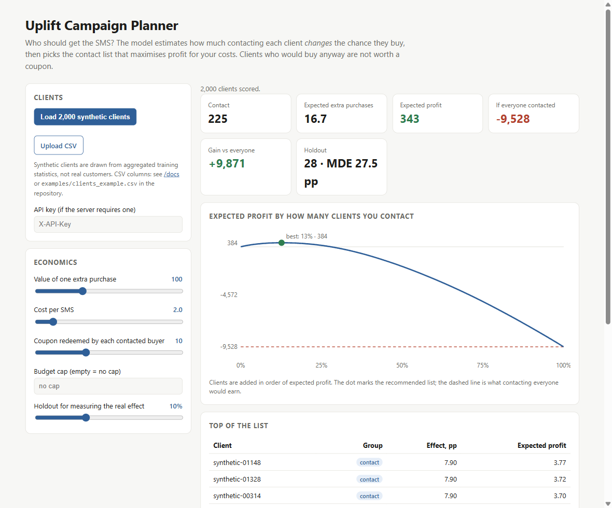
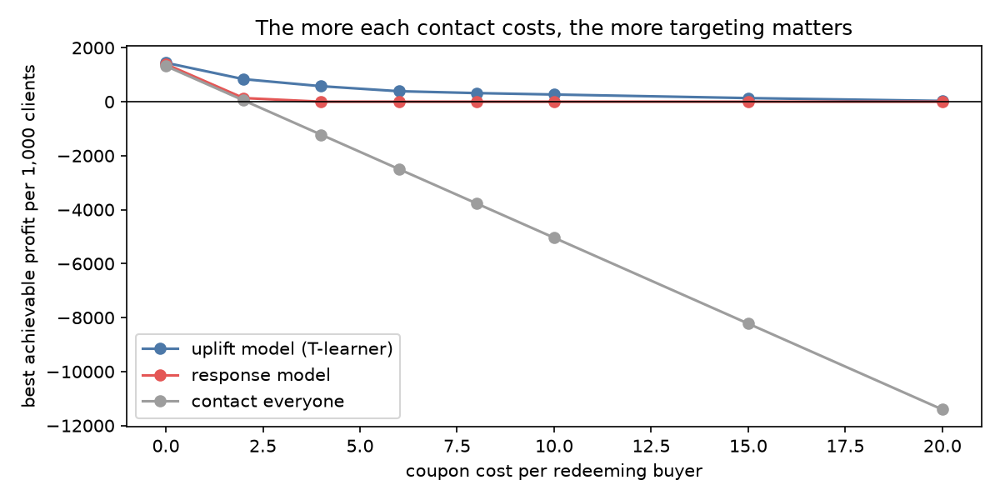
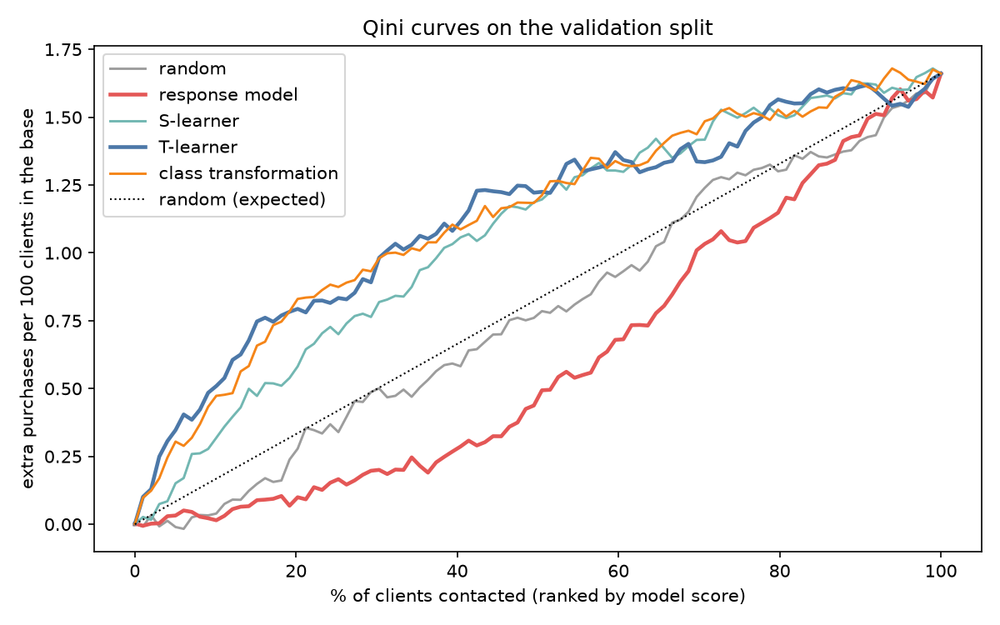
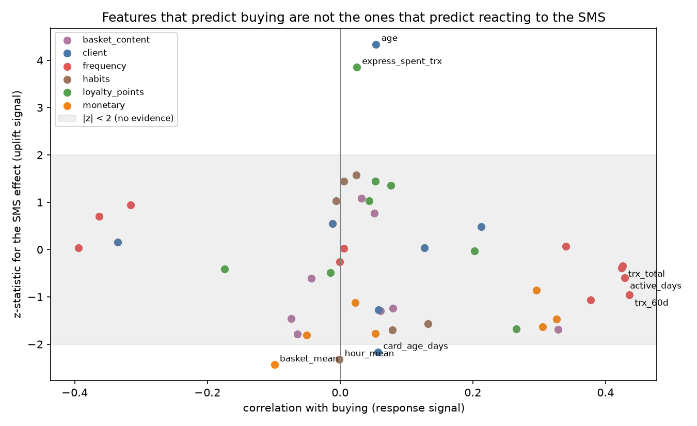
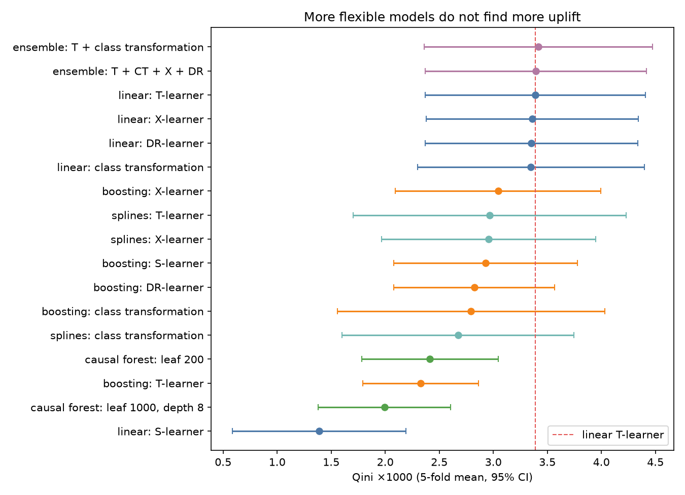
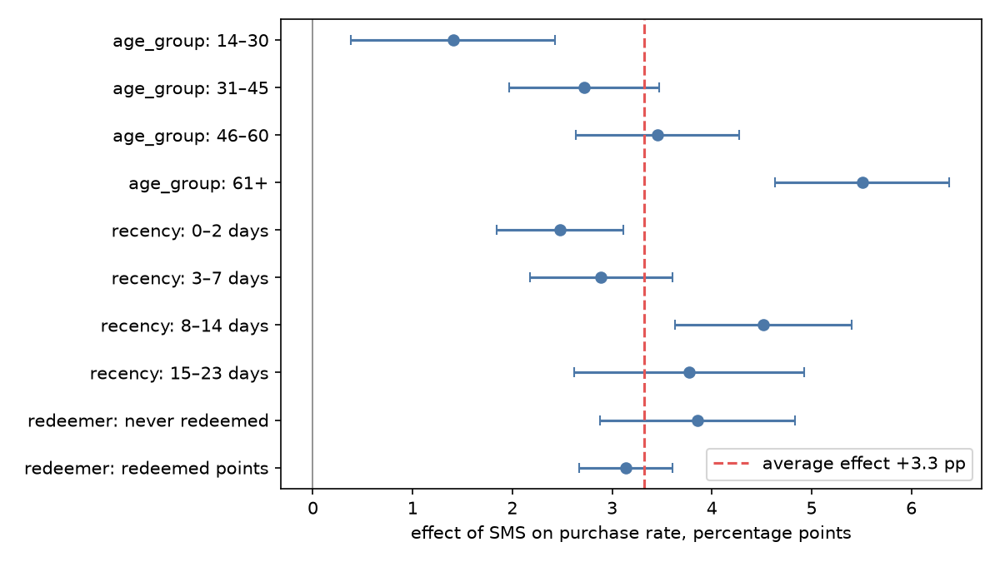

# Who should get the campaign? Uplift modelling for marketing budgets

Most targeting models answer *"who will buy?"* and send the discount to them. Many of those customers would have bought
anyway, so the budget is wasted, and some customers buy *less* after being contacted. This project estimates the
**causal effect of a campaign on each customer** and turns it into a list that maximises incremental profit for a given
budget.

The same approach applies wherever a company pays to contact customers: bank cross-sell, telecom retention offers,
e-commerce coupons, insurance, delivery apps.


**Try it:** `docker compose up --build`, then open http://127.0.0.1:8080: load synthetic clients, move the cost
sliders and watch the contact list and expected profit change.



**What this project shows**
- Causal ML on a real randomised campaign: S/T/X/DR-learners, class transformation, causal forests, Qini evaluation
  with paired bootstrap and cross-validated intervals.
- Finding and fixing leakage that inflates offline scores up to 2.9×, plus a training/serving skew test.
- Choosing the simplest model when complex ones do not beat it beyond noise, and saying so.
- Turning predictions into money: profit curves, coupon economics, holdout design for the next campaign.
- Production: FastAPI with validation and API keys, drift monitoring, Docker, CI, HTTPS deployment recipe.

## Results on the held-out test set (40,008 clients, evaluated once)

| Strategy | Extra purchase rate in top 10% | Qini ×1000 (95% CI) |
|---|---|---|
| Random 10% | +1.0 pp | −0.51 [−2.03, 0.85] |
| **Response model** ("who will buy", what most teams use) | **+0.7 pp** | **−1.30 [−2.53, −0.00]** |
| **Uplift model** (logistic T-learner) | **+7.9 pp** [4.8, 10.9] | **1.99 [0.75, 3.30]** |

Campaign average: +3.3 pp. The uplift model beats the response model by +7.2 pp in the top 10% (paired CI +3.9 to
+10.7); the response model is no better than random.

**What it is worth.** The data has no prices, so economics are scenarios: an extra purchase is worth 100, an SMS costs 2,
and optionally the SMS carries a coupon redeemed by every contacted buyer.



| Scenario (profit per 1,000 clients in the base) | Contact everyone | Best with response model | Best with uplift model |
|---|---|---|---|
| Plain SMS | 1,324 | 1,391 | **1,443** (contact 93%) |
| SMS + coupon of 2 | 51 | 135 | **836** |
| SMS + coupon of 10 | −5,041 | 0 (contact nobody) | **266** (contact top 5–9%) |

With a plain SMS the average effect already pays for the message, so targeting adds ~9%. As soon as the contact
carries an offer, the 60% of clients who would buy anyway redeem it for nothing: contacting everyone loses money and
the response model can only recommend doing nothing, while uplift targeting stays profitable.

**Who the model contacts first** (top 10% vs the rest, test split): median age 62 vs 43, average basket 271 vs 410,
8 vs 17 purchases in four months, newer loyalty cards, 27% vs 17% have used promo points, 50% vs 35% women.

**Second industry.** The same pipeline on 3M users of Criteo's randomised ad campaign (online advertising): there the
response model is already decent, because ad effects concentrate on likely visitors, but the uplift model is still
significantly better (+1.1 pp in the top 10%, paired CI +0.4 to +1.8). How much uplift modelling adds is a property of
the business, so it has to be measured on a randomised campaign, not assumed.

Calibration, sleeping-dog check and limits: [`models/MODEL_CARD.md`](models/MODEL_CARD.md),
[`notebooks/06_test_and_business.ipynb`](notebooks/06_test_and_business.ipynb).

## Baselines: the response model targets the wrong people



With identical features and the same logistic-regression pipeline, on 40,008 validation clients:

| Strategy | Extra purchase rate in top 10% | Qini ×1000 (95% CI) |
|---|---|---|
| Random 10% | +0.7 pp | −0.49 [−1.74, 0.76] |
| **Response model** ("who will buy", what most teams use) | **+0.4 pp** | **−2.18 [−3.41, −0.97]** |
| T-learner (uplift) | **+10.2 pp** | **3.03 [1.66, 4.48]** |
| Class transformation (uplift) | +9.4 pp | 3.01 [1.63, 4.38] |

The response model is *significantly worse than random targeting*: 95% of the clients in its top decile buy without
the SMS, so the message changes nothing for them. The uplift models find clients whose purchase rate rises by
~10 pp when contacted, three times the campaign average. Details: [`notebooks/03_baselines.ipynb`](notebooks/03_baselines.ipynb).

## Who reacts to the SMS? Not who buys the most

40 behavioural features were built from the 45.8M-row purchase log (frequency, spend, loyalty points, basket content,
shopping habits). Features that predict *buying* carry no evidence of a different *SMS effect*:



The clients who react are identifiable and easy to explain to a marketing team (95% CI; first two rows on the
train+valid pool, age row from notebook 01 on all labelled clients):

| Segment | SMS effect | Rest of base |
|---|---|---|
| Used promo (express) points before | **+6.3 pp** [5.2, 7.4] | +2.7 pp [2.1, 3.2] |
| Smallest-basket quartile | **+5.3 pp** [4.3, 6.2] | +2.6 to +2.9 pp |
| Age 61+ | **+5.5 pp** [4.6, 6.4] | +1.4 pp at age 14–30 |

Throwing all 40 features into the model does **not** improve targeting (5-fold CV, paired: Δ Qini −0.40, CI
includes 0), and frequency features alone make it significantly worse. The uplift signal is low-dimensional, so step 5
works on better learners rather than more features. Details: [`notebooks/04_features.ipynb`](notebooks/04_features.ipynb).

## Model selection: the simple model wins

17 configurations from five families (linear meta-learners, spline bases, gradient boosting, causal forests via
`econml`, rank ensembles), all on the same 5 folds of 160k clients:



| | Δ Qini ×1000 vs linear T-learner (paired, 95% CI) |
|---|---|
| Ensembles (T + class transformation; T + CT + X + DR) | +0.03 [−0.02, 0.08] · +0.01 [−0.02, 0.03] |
| Linear X-, DR-learner, class transformation | −0.03 to −0.04, all CIs include 0 |
| Splines, gradient boosting | −0.35 to −1.06 (boosted T-learner and spline class transformation significantly worse) |
| Causal forests | −0.98 [−1.89, −0.06] · −1.40 [−2.49, −0.31] |

Nothing beats a **logistic T-learner** beyond noise, and the flexible models are worse: with a +3.3 pp effect on a
60% base rate, they spend their capacity on the purchase signal and on noise. The selected model trains in seconds,
scores in microseconds and every coefficient is explainable. (Error bars in the plot are per-model across folds;
significance comes from the paired differences in the table.) Details: [`notebooks/05_model_selection.ipynb`](notebooks/05_model_selection.ipynb).

## API

FastAPI service around the trained model ([`src/uplift/api.py`](src/uplift/api.py)); interactive docs at `/docs`.

| Endpoint | What it does |
|---|---|
| `GET /health` | model version and test metrics (no auth) |
| `POST /score` | per client: calibrated SMS effect, purchase probability with/without contact, tier (high / medium / low) |
| `POST /plan` | who to contact for given value, SMS cost, coupon cost and budget; expected profit vs contacting everyone |
| `POST /score/batch` | CSV in, CSV out (extra columns pass through; every row is validated) |
| `POST /drift` | Population Stability Index of each input vs the training population (stable / watch / drift) |
| `GET /demo/sample` | synthetic clients drawn from aggregated training statistics (no real rows) |
| `GET /` | the interactive campaign planner shown above |

```bash
uvicorn uplift.api:app --app-dir src --port 8000          # set UPLIFT_API_KEY to require X-API-Key
curl -X POST localhost:8000/score/batch -H "X-API-Key: $UPLIFT_API_KEY" -F file=@examples/clients_example.csv
```

`/plan` with a coupon of 10, for the two example profiles below, contacts the first and skips the second:

```json
{"summary": {"clients": 2, "contacted": 1, "expected_profit": 0.57, "profit_if_everyone_contacted": -8.47},
 "clients": [{"client_id": "p", "contact": true,  "expected_effect_pp": 7.90, "expected_profit": 0.57},
             {"client_id": "s", "contact": false, "expected_effect_pp": 1.83, "expected_profit": -9.04}]}
```

(`p`: 64-year-old, small baskets, newer card; `s`: frequent big-basket shopper who buys anyway.)

Design choices:
- **Calibrated money, unchanged ranking.** The raw T-learner effects are well ordered but compressed (notebook 06),
  so money estimates use an isotonic map from predicted to observed effect fitted on the test deciles.
- **Offers are priced per client.** The T-learner's treated-arm probability tells how likely a contacted client is to
  redeem a coupon, so `/plan` skips "sure things" when the offer is expensive.
- **No training/serving skew.** Derived flags (invalid age, has redeemed, redeemed before issue) are computed inside
  the API from raw fields. A test compares them with the training table: it caught 50 test clients whose flag had been
  derived from timestamps in training but could only be derived from whole days at serving time. The training
  definition was changed to match and the model retrained.
- Validation: unknown fields are rejected, impossible ages are treated as missing like in training, ranges are
  checked; batch errors name the CSV row. 40,008 clients score in ~1 s.
- **The next campaign measures itself.** `/plan` takes `holdout_share`: a deterministic random slice (hashed
  `client_id`) of the selected clients is held out, and the response states the smallest effect the
  contact-vs-holdout comparison will be able to detect. Those pairs are fresh randomised training data.
- **Drift check before scoring.** Decile profiles of every input are stored with the model; `/drift` flags a client
  base that no longer looks like the one the effect was estimated on (e.g. +20 years of age → PSI > 1).

## Deployment

- `Dockerfile`: runtime dependencies only (no DuckDB, econml or notebooks), non-root user, health check.
- `docker-compose.yml` for local use; [`deploy/`](deploy/README.md) adds Caddy for automatic HTTPS on a DigitalOcean
  droplet, plus the retraining and campaign routine.
- GitHub Actions ([`.github/workflows/ci.yml`](.github/workflows/ci.yml)): tests on the runtime dependency set
  (data-dependent tests skip themselves), then builds the image and smoke-tests `/health`, the API key and a batch call.

## Data

[X5 RetailHero uplift dataset](https://ods.ai/competitions/x5-retailhero-uplift-modeling): a grocery retailer's loyalty
programme with a **randomised SMS campaign**.

| | |
|---|---|
| Clients | 400,162 (200,039 in the labelled campaign) |
| Purchase history | 45.8M line items, 8.0M transactions, 2018-11-21 → 2019-03-18 |
| Design | 50/50 random assignment to SMS vs. no SMS |
| Outcome | purchase after the campaign |

The data is not redistributed here: `scripts/download_data.py` fetches it from a public mirror of the competition files.

## Data audit

**1. The campaign works, but weakly on average.** Purchase rate 60.33% without SMS vs 63.65% with SMS:
**+3.32 pp (95% CI +2.90 … +3.75)**. Sending the SMS to everyone buys roughly 3 extra customers per 100 messages.

**2. The effect is heterogeneous**, so targeting can do much better than "send to everyone":



**3. Randomisation holds.** Treated share 49.98% (binomial p = 0.87), max standardised mean difference 0.0085 across
age, gender, tenure, spend and recency. Differences between groups are causal effects.

**4. Two traps that inflate results, both fixed:**

- **Leakage in `first_redeem_date`.** The column runs until 2019-11-20, eight months after the campaign. For 44,953
  clients the "first redemption" happened *after* the SMS, and treated clients have it slightly more often
  (11.49% vs 11.10%). The competition's reference solution uses this column as it is; here it is censored at the
  campaign start and covered by a test. How much it matters depends on the learner: with logistic regression the
  leaky Qini is only ~10% higher, but **gradient boosting finds the leak and its offline Qini grows 1.9–2.9×**, a
  "modelling win" that would vanish in production.
- **`purchase_sum` is repeated on every line item.** Summing it over rows overstates spend **10.3×**; all
  transaction-level values are de-duplicated first.

Other data issues handled: 1,779 impossible ages (e.g. −7491, 1901), 536 redemptions dated before card issue.
Limitation: every client bought something in the last 23 days before the campaign, so results describe *active* customers.

## Evaluation protocol

`train / valid / test = 60 / 20 / 20`, stratified by treatment × outcome. Each split keeps the same treated share,
base rates and ATE (±0.002 pp), with max |SMD| < 0.025 ([split report](reports/split_report.csv)). The test split is not
touched until the final evaluation. Metrics: uplift@k and Qini curve with bootstrap intervals. Accuracy and AUC cannot
measure uplift because no customer is observed both with and without the SMS.

## Roadmap

1. ✅ Problem and data audit: [`notebooks/01_eda.ipynb`](notebooks/01_eda.ipynb)
2. ✅ Leakage-free customer table and splits: [`src/uplift/dataset.py`](src/uplift/dataset.py)
3. ✅ Baselines: random, response model, S/T-learner, class transformation: [`notebooks/03_baselines.ipynb`](notebooks/03_baselines.ipynb)
4. ✅ Behavioural features, uplift-vs-response screening, CV ablation: [`notebooks/04_features.ipynb`](notebooks/04_features.ipynb)
5. ✅ Model selection: 17 configurations, causal forests, ensembles: [`notebooks/05_model_selection.ipynb`](notebooks/05_model_selection.ipynb)
6. ✅ Test evaluation, calibration, profit curves, Criteo transfer check, saved model + card: [`notebooks/06_test_and_business.ipynb`](notebooks/06_test_and_business.ipynb)
7. ✅ FastAPI service: `/score`, `/plan`, `/score/batch`, API key, training/serving skew test
8. ✅ Docker, CI, HTTPS deployment recipe, interactive demo, holdout design, drift monitoring: [`deploy/README.md`](deploy/README.md)

## Reproduce

```bash
python -m venv .venv && .venv/Scripts/pip install -r requirements-dev.txt   # Windows; use .venv/bin on Linux/macOS
python scripts/download_data.py --criteo   # ~620 MB X5 + 311 MB Criteo
python scripts/build_dataset.py      # one row per client + splits
python scripts/build_features.py     # 40 behavioural features
python scripts/train_final.py        # fit, calibrate, save models/uplift_model.pkl
pytest -q                             # 39 tests: leakage, splits, metrics, learners, money, API, skew
jupyter nbconvert --execute --to notebook --inplace notebooks/0*.ipynb
```

## Project structure

```
src/uplift/data.py       loading, cleaning, leakage fix
src/uplift/dataset.py    customer table, splits, balance report
src/uplift/features.py   40 behavioural features from the purchase log (DuckDB, ~30 s)
src/uplift/metrics.py    uplift@k, Qini curve/coefficient, paired bootstrap, k-fold CV
src/uplift/models.py     response model, S/T/X/DR-learners, class transformation, causal forest,
                         rank ensemble, uplift screening, selected_model()
src/uplift/business.py   decile tables, profit curves, optimal contact share, contact plan
src/uplift/criteo.py     second-industry transfer check (online advertising)
src/uplift/artifact.py   save/load the trained model with metadata
src/uplift/train.py      final fit, isotonic calibration, tier thresholds (scripts/train_final.py)
src/uplift/api.py        FastAPI service (+ static/index.html demo page)
src/uplift/monitoring.py PSI drift report
src/uplift/synthetic.py  synthetic demo clients from aggregated statistics
examples/                example client CSV for the API
models/                  trained model, metadata and MODEL_CARD.md
scripts/                 download and build entry points
notebooks/01_eda.ipynb   data audit, randomisation check, ATE, heterogeneity
notebooks/03_baselines.ipynb  response model vs uplift models, leakage experiment
notebooks/04_features.ipynb   purchase signal vs uplift signal, feature-group ablation
notebooks/05_model_selection.ipynb  17 configurations, paired CV comparison, coefficient reading
notebooks/06_test_and_business.ipynb  single test evaluation, calibration, profit, Criteo, model export
tests/                   leakage, split, metric, model, business and API tests
Dockerfile, docker-compose.yml, deploy/, .github/workflows/ci.yml
docs/plan_az.csv         project plan (Azerbaijani)
```
